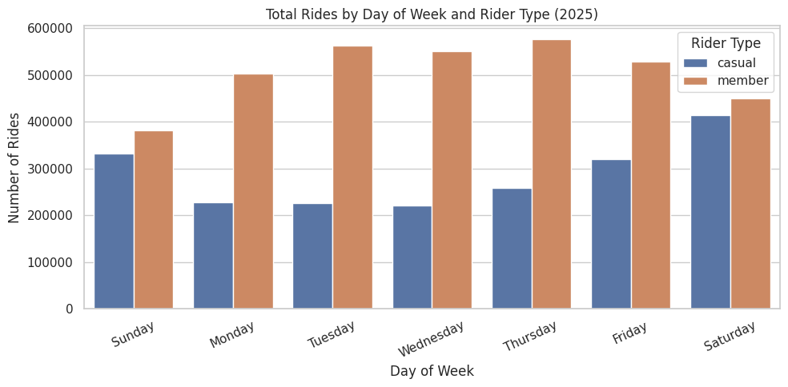
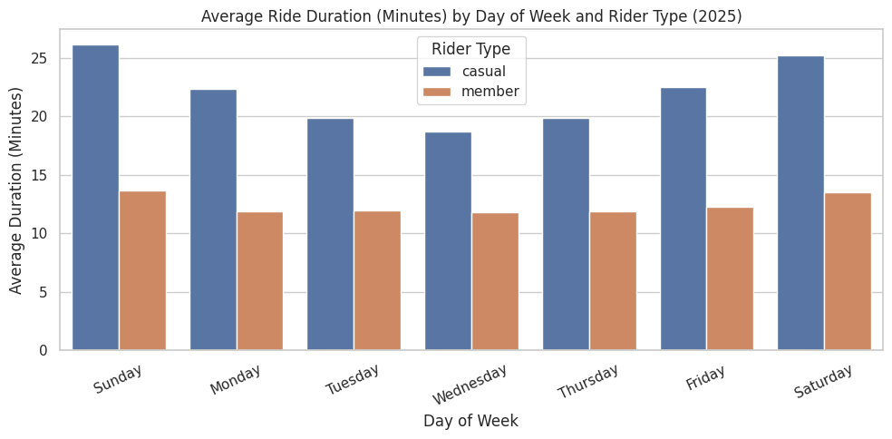

## Cyclistic Bike-Share Analysis: Casual Riders vs. Annual Members

**Google Data Analytics Capstone Project**

### About the Company

Cyclistic is a fictional bike-share company in Chicago with 5,824 bicycles and 692 stations. It offers two types of plans: single-ride/full-day passes and annual memberships.

### Business Goal

The primary focus of this analysis is to distinguish between **casual riders** (who purchase single-ride or full-day passes) and **annual members**, in order to develop strategies for converting casual riders into annual members.

### About the Dataset

The data has been provided by Motivate International Inc. under a royalty-free licence. The analysis is based on trip data for the **full year 2025**.

### Repository Contents

| File | Description |
|------|-------------|
| `divvy-tripdata_2025.ipynb` | Jupyter Notebook with the Python code, the written analysis, and the charts |
| `visualizations` | Charts generated by the notebook |

### Visualizations

**1. Total Rides by Day of Week and Rider Type**

Members ride mostly on weekdays, which suggests commuting use. Casual ridership rises toward the weekend and peaks on Saturday, when it comes closest to the number of member rides.

**2. Average Ride Duration by Day of Week and Rider Type**

Casual riders take longer trips than members on every day of the week, roughly 19 to 26 minutes on average versus 12 to 14 minutes for members. The longest rides for both groups occur on weekends.

**3. Monthly Ride Volume by Rider Type**

Both groups follow a strong seasonal pattern, with a peak in the summer months (around August) and a sharp drop in winter. The decline is much steeper for casual riders, whereas members maintain a more stable base of rides throughout the year.

### Key Findings

- **Different usage patterns:** members ride mainly on weekdays and take shorter trips, while casual riders concentrate on weekends and take longer trips.
- **Strong seasonality among casual riders:** their activity is concentrated in the warmer months.
- **Longer trips by casual riders:** their average duration is consistently higher than that of members.

### Recommendations

1. **Introduce flexible, shorter-term memberships.** Convert casual riders into members by offering flexible subscription tiers with shorter commitment periods, such as weekend-only or seasonal summer passes.

2. **Adjust the pricing structure for extended rides.** Since casual riders take longer trips on average, consider offering preferential or capped rates for long-duration rides to incentivise annual membership sign-ups.

3. **Launch targeted seasonal and weekend campaigns.** Run marketing campaigns that highlight the cost savings and benefits of an annual membership, specifically during the summer months, on weekends, and for long-duration rides.

### Tools

- Python
- Jupyter Notebook
- pandas
- matplotlib / seaborn

### Roadmap

- [ ] Ride duration distribution (boxplot / density plot)
- [ ] Heatmap of usage by day of week and hour of day
- [ ] Geographic analysis of start stations
- [ ] Breakdown by bike type

## Author

*Your name*, [GitHub](https://github.com/your-username) | [LinkedIn](https://www.linkedin.com/in/your-profile)
